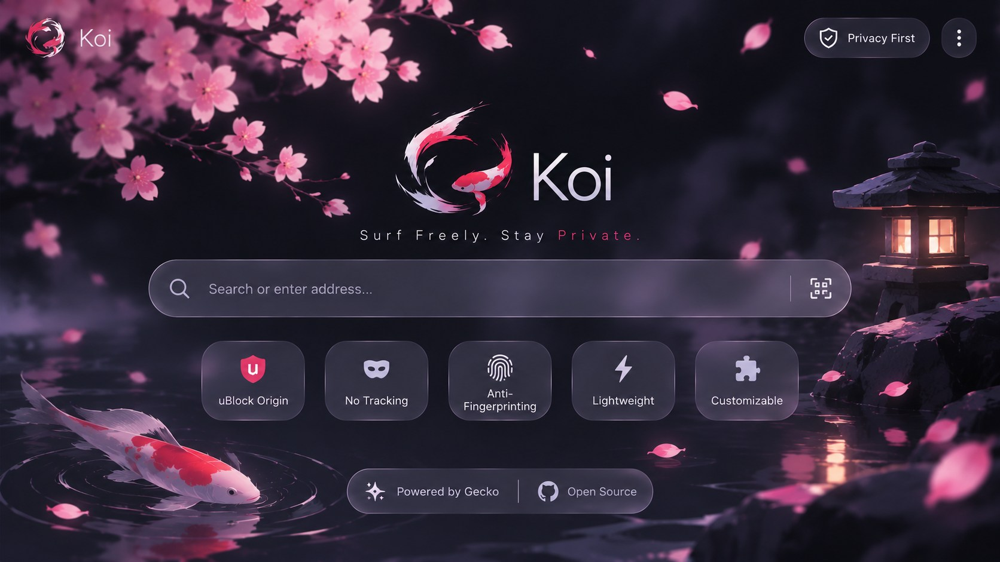
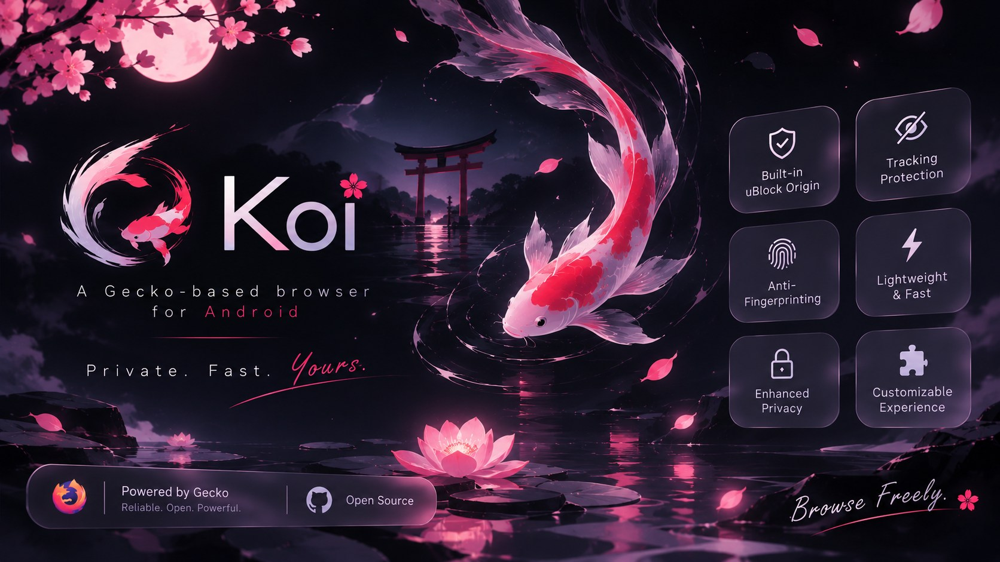
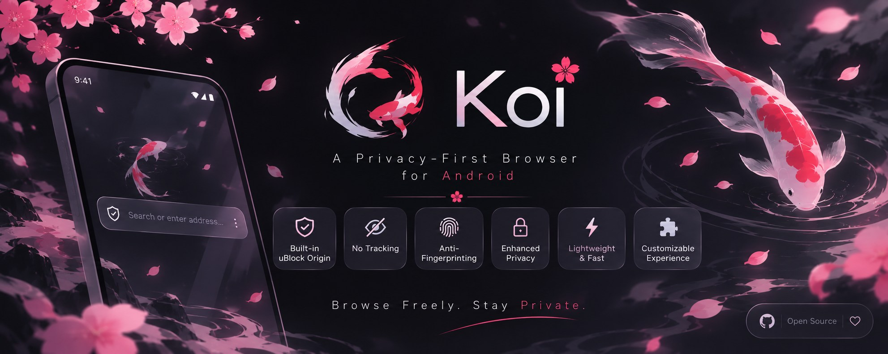

<p align="center">
  
</p>

<h1 align="center">Koi</h1>

<p align="center">
  <b>Private. Fast. Yours.</b><br>
  A Gecko-based browser for Android.
</p>

<p align="center">
  <a href="https://github.com/r1versed/koi-browser/releases/latest"></a>
</p>

<p align="center">
  
  
  
</p>

---

## About

Koi is a privacy-first browser for Android, built on Mozilla's GeckoView engine. It blocks ads and trackers out of the box.

> Early build: expect rough edges, and please report them in [Issues](https://github.com/r1versed/koi-browser/issues).

## Features

| | |
|---|---|
| **Built-in uBlock Origin** | Ads and trackers are blocked from the first launch. |
| **Tracking protection** | Block trackers and third-party cookies, with settings you can tune. |
| **Anti-fingerprinting** | Makes it harder for sites to single out your device. |
| **Enhanced privacy** | Private tabs, HTTPS-only mode and DNS over HTTPS. |
| **Lightweight and fast** | Gecko engine, gesture-first interface, no bloat. |
| **Customizable** | Colors, address bar styles, app icons, and your own homepage wallpaper. |
| **Firefox extensions** | Works with compatible Mozilla-signed Firefox extensions. |
| **Video finder (experimental)** | Spots video files a page loads and lets you save direct files to Downloads/Koi. |

## Preview

_Artwork and concept previews._

<p align="center">
  
</p>

<p align="center">
  
</p>

## Install

1. Open the [latest release](https://github.com/r1versed/koi-browser/releases/latest) on your phone and download the APK.
2. Open the file. If Android asks, allow your browser or file manager to install unknown apps.
3. Koi is not on the Play Store yet, so Google Play Protect may warn you. Tap **More details**, then **Install anyway**.

Requires Android 13 (API 33) or newer.

## Build from source

You need Git, JDK 17, Python 3 and the Android SDK. Gradle downloads the platform and NDK it needs once the SDK licenses are accepted.

```powershell
git clone https://github.com/r1versed/koi-browser.git
cd koi-browser
$env:ANDROID_HOME = "C:\Android\sdk"
.\gradlew.bat :app:assembleFullDebug
```

On macOS or Linux use `./gradlew`. The APK is written to `app/build/outputs/apk/full/debug/`.

For a release build, copy `keystore.properties.example` to `keystore.properties`, fill in your own signing key and run `:app:assembleFullRelease`. Never commit your keys.

## Credits

Koi is built on Mozilla's GeckoView and bundles uBlock Origin by Raymond Hill and contributors. The full list of third-party components is in [`app/src/main/assets/third_party_notices.txt`](app/src/main/assets/third_party_notices.txt).

## License

Koi is released under the [Mozilla Public License 2.0](LICENSE).

Firefox and Gecko are trademarks of the Mozilla Foundation. Koi is not affiliated with or endorsed by Mozilla.
